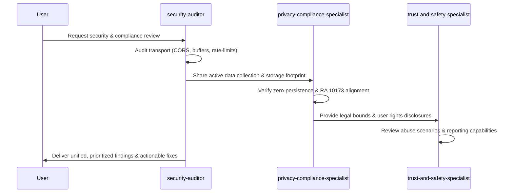

# Multi-Agent Collaboration Protocol for esmiringle

This document establishes the collaboration rules and interaction workflows between `security-auditor`, `privacy-compliance-specialist`, and `trust-and-safety-specialist`.

---

## 1. Collaboration Matrix

| Task Type | Primary Agent | Supporting Agents | Output Artifact |
| :--- | :--- | :--- | :--- |
| **Security Audit** | `security-auditor` | `privacy-compliance-specialist` (IP/data retention), `trust-and-safety-specialist` (abuse vectors) | Security Assessment Report & prioritized remediation list |
| **Privacy & Legal Update** | `privacy-compliance-specialist` | `security-auditor` (transport/storage verification) | Updated Privacy Policy, Terms of Service & Disclosures |
| **Safety & Moderation Review** | `trust-and-safety-specialist` | `security-auditor` (rate limits & reporting events), `privacy-compliance-specialist` (strike retention) | Community Guidelines, Safety Center FAQ & Moderation Rules |
| **Full Platform Review** | All Three Agents (Consolidated) | Cross-review and gap alignment | Comprehensive Platform Readiness Report |

---

## 2. Standard Tri-Agent Workflow

---

## 3. Guiding Principles During Collaboration

1. **Empirical Truth Over Assumptions**: No specialist may assume a feature or security control exists without verifying active source code.
2. **Context Efficiency**: Do not invoke all agents for tasks strictly within one domain (e.g. only invoke `security-auditor` for raw dependency vulnerability checks).
3. **No Over-Promising**: `trust-and-safety-specialist` and `privacy-compliance-specialist` must never publish policies promising automated AI moderation or persistent chat logs since the application is strictly an ephemeral text router.
4. **Preserve Application Performance**: Any proposed security or moderation safeguard must maintain sub-second latency and zero user registration friction.
